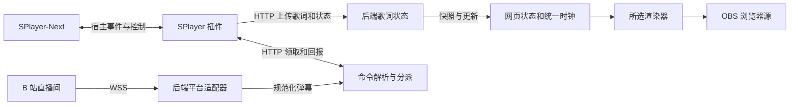

# SPlayer Live Player 开发文档

交接日期：2026-11-11。正式应用尚未建立；现有代码为两个独立验证程序。本文是新对话的开发入口，需求细节和验证证据见 [文档索引](docs/README.md)。

**第一优先级：各端对接。** 先确定接口、数据归属、可替换边界和恢复行为，再按链路验证。第一个开发任务是用轻量歌词页跑通「SPlayer-Next 插件 → 本地后端 → OBS 浏览器源」。

**第二优先级：性能。** 从首个版本保留全文与进度分离、单一同步时钟、渲染器按需加载和资源释放。各链路正确后，在真实 OBS 场景测量开销，再决定采样率、渲染节奏和优化目标。

## 已确认的范围

- 首版同机运行：用户启动本地后端、导入 SPlayer-Next 插件，再将歌词输出 URL 加入 OBS 浏览器源。音频由 SPlayer 和 OBS 处理。
- 用户可选择已实现的歌词展示方式。AMLL 是可选渲染器；公共协议、时钟及轻量模式独立于 AMLL，先为其他方式预留注册接口。
- 长期支持 B 站「点歌 xxx」及更多指令。点歌按配置音源搜索，播放返回的第一项；无结果或首项失败时明确回报。未来指令通过类型和处理器扩展。
- 首版聚焦一台电脑、一个活动播放器和一个 B 站房间。云端、局域网部署、跨平台直播间和直播音视频处理留待有明确需求时再设计。

## 对接矩阵

| 边界 | 首选方式 | 当前依据与首个验收 |
| --- | --- | --- |
| SPlayer → 采集插件 | 订阅 `trackChange`、`lyricChange`、`lineChange`、`playStateChange`；用 `getNowPlaying()` 校准 | [插件事件与查询](SPlayer-docs/docs/plugins/control.md)有文档；真实歌词载荷、事件顺序、曲目归属、偏移待测 |
| 采集插件 → 后端 | `splayer.request` 向回环地址 HTTP POST；歌词全文按修订、播放位置按采样提交 | `network`／`control` 已用于点歌实验；歌词上传大小、重试、时延及重启后重送快照待测 |
| 后端 → 网页 → OBS | 同源托管；优先验证本项目 WebSocket 快照及更新协议，SSE 可作单向分发备选；OBS 加载独立的透明输出页 | SSE 已用于弹幕示例，歌词传输及 OBS 同步尚未联调。先定一种传输，由协议测试覆盖首连、刷新、断开和恢复 |
| 网页 → 渲染器 | 公共歌词模型及单一时钟，通过注册表选择并加载渲染器 | 先接轻量逐行实现，再验证 AMLL 逐字、动态加载、切换和销毁，见 [渲染器草案](docs/renderers.md) |
| B 站 → 后端 | 后端管理账号会话，获取直播 token 并接收 WSS；游客单独建会话 | 游客与登录模式均已实测；登录样本收到发送者 UID 与昵称。见 [接入方案](docs/bilibili-ingress.md) |
| 弹幕 → 后端命令 | 规范化事件，解析「点歌 + 空白 + 非空关键词」，由命令注册表分派 | 尚未串联。先用固定样本验证解析、去重、身份限制和忙碌结果，再在指定房间联调 |
| 后端 → 插件 → SPlayer | 插件主动 HTTP 轮询领取，调用 `searchOnline`、`playTrack`，再查询实际状态并回报 | 已在 SPlayer-Next 1.2.0／插件 API 5 真实验证；正式应用的命令生命周期待实现 |

插件只使用文档化能力，按 API 4 或以上设计，首次联调用已验证过的 API 5 环境。`splayer.request` 需要 `network`，播放状态查询和控制需要 `control`。宿主外部 HTTP、WebSocket、MCP 保留为将来有明确需求时的候选；首版不要求用户启用它们，也不假设插件能监听端口或启动本地进程。接口限制见 [参考资料分析](docs/reference-notes.md)。

图中的歌词状态、平台适配器和命令分派是同一后端进程内的模块。歌词状态和命令结果分别更新，弹幕连接失败时歌词展示仍可工作。网页设置区负责连接诊断、账号操作及渲染器选择，OBS 输出页只消费展示配置和歌词状态。

## 已验证的基线

| 验证程序与证据 | 可以直接参考 | 尚未证明 |
| --- | --- | --- |
| [后端到 SPlayer 实验](experiments/song-request/README.md) · [实测记录](experiments/song-request/validation.json) | 后端请求被插件领取；网易云「晴天」搜索首项原样传入 `playTrack`；`getNowPlaying` 核对 ID、来源和 `playing` | 歌词上传与 OBS、其他音源、直播弹幕触发播放。单次约 3.26 秒只作实测记录 |
| [B 站示例](experiments/bilibili-live/README.md) · [账号验收](experiments/bilibili-live/account-validation.json) · [游客实测](experiments/bilibili-live/guest-validation.json) | 账号模式通过校验、直播认证和心跳，并收到带 UID／昵称的弹幕；游客收到文本，样本 UID 缺失且昵称脱敏 | 所有消息都有身份、长期稳定性、自动刷新、弹幕到点歌的闭环 |
| [AMLL 源码分析](docs/amll-integration.md) | 本地 Core／Vue 源码的字段映射和生命周期，逐字时间及可选字段的适配思路 | 正式依赖版本、真实歌词驱动、OBS 透明合成与实际开销 |

B 站继续采用已验证的「账号校验 → 解析真实房间号 → 同会话取 token → WSS 认证及心跳 → 解包 `DANMU_MSG`」路径。二维码以已验证的官方返回域名为依据，Cookie 导入作为备选；二维码显示与账号模式验收分别有证据。需要身份的指令优先登录，游客仅作文本接收和诊断，仍按每条消息判定身份是否可用。参考资料是本地快照，出现接口变化时按阶段复验。

## 首版契约草案

这些名称用于新对话起步，实际端点与类型在实现及测试中固定。公共模型使用毫秒、版本与稳定标识，平台字段在适配层转换。

| 对象 | 主要字段与规则 |
| --- | --- |
| 插件会话 | `protocolVersion`、`sessionId`、`seq`、宿主版本及 API 级别。重启后建立新会话；拒绝旧会话的迟到消息和旧序号 |
| 曲目与歌词文档 | 曲目标识包括来源与 ID；`trackRevision` 隔离切歌，`lyricRevision` 管理全文。保留行与字时间、翻译、音译、背景行及对唱标记，可选字段缺失时降级 |
| 播放采样 | 对应曲目修订、播放状态、`positionMs`、倍率、歌词偏移、采样时间、行索引或跳转标记。先实测宿主位置及偏移含义；统一定义采样时间与浏览器单调时钟的映射 |
| 网页状态 | 首连／恢复获得完整 `snapshot`，后续按序接收 `update`。检测间隙、后端重启或未知修订时重新同步；读快照和订阅期间的更新不能遗漏 |
| 弹幕事件 | 来源平台、房间 ID、文本、可用消息 ID、可用发送时间、发送者 UID／昵称及身份状态；接收账号单独记录。缺失或受限显式标记，不从昵称推断 UID |
| 命令及结果 | `commandId`、`type`、参数、创建时间、执行会话和结果。区分排队、已派发、已确认播放、失败、未确认和过期；迟到回报不能覆盖新执行结果 |

最先处理歌词归属：`lyricChange` 载荷只有 `lines`，缺少曲目 ID。采集实验要记录启用、快速切歌和歌词迟到时的实际顺序。切歌后先清空旧文档，待确认归属后再发布歌词；项目自己的序号只能处理传输乱序，不能证明宿主事件属于哪首歌。

时钟以采样为锚点：播放时按倍率推进，暂停时冻结，seek、曲目变化和场景恢复时校准。宿主、后端和浏览器时钟不可直接相减，歌词偏移只应用一次。失联时停止推进，建议输出留空并在设置页显示原因。细节见 [架构方案](docs/architecture.md)。

点歌保留独立执行边界。首个对接版本建议一条在途命令、忙碌时明确回报、超时不自动重放；是否排队、冷却、允许身份缺失时点歌由后续验收决定。播放接口调用成功后，仍须用宿主状态确认结果。

## 工程与开发顺序

建议同仓库按 `plugin/`、`backend/`、`web/`、`shared/` 分层，目录名可随构建方式调整。Node.js 作为后端基线，TypeScript 作为共享契约候选，网页先用简单 DOM。正式插件交付为可导入的单文件，构建后不依赖 Node 模块、DOM 或 Electron 接口。依赖和包管理器在首轮构建时确定并锁定，避免把实验目录直接当正式应用或把 SPlayer 原生构建工具链引入项目。

| 顺序 | 工作与交付 | 通过后继续 |
| --- | --- | --- |
| 1. 歌词对接 | 建正式目录、定义最小契约；用模拟载荷开发后端、设置诊断与透明单行原型，同时用导入插件记录真实宿主事件 | 单曲「插件 → 后端 → 网页 → OBS」可见，支持播放、暂停、拖动、切歌和刷新；可区分没有歌词、宿主断连和后端未启动 |
| 2. 恢复与展示对接 | 固定快照与增量规则、时钟映射；通过注册表接入可选 AMLL，轻量原型作为独立实现 | 快速切歌不串词；重启、重连和 OBS 场景恢复可重新同步；两种模式使用同一份歌词和时钟，切换释放旧实例 |
| 3. 弹幕与命令对接 | 将已验证的 B 站适配逻辑移到正式后端；先用固定样本和显式启用的测试命令联调，再接入真实房间 | 一条明确的「点歌 xxx」只分派一次并播放音源首项，日志可关联收到弹幕、领取命令和宿主确认；游客、断线、无结果和忙碌结果清楚 |
| 4. 性能验收与优化 | 在同一台机器和同一 OBS 场景测量两种渲染方式，按证据调整开销 | 满足下文资源约束，记录并比较实测基线，确认优化没有破坏同步与恢复 |

在第 1 步开始前，先选一个未占用的本地端口，记录启动、构建及测试命令。实验用 `19630`、`19631`、`19632` 可能已有进程，新应用不要依赖它们正在运行。保留 `experiments/` 作为复验入口；真实播放、扫码和房间联调由用户在相应阶段操作。后端仅监听回环地址，管理／命令操作与 OBS 输出分开；B 站凭据保留在后端，本阶段沿用内存会话。

## 性能设计与测量

| 重点 | 首版约束 | 如何验证 |
| --- | --- | --- |
| 采集与传输 | 歌词全文只在修订变化或重新同步时发送；进度更新合并，限制在途请求和积压。`250–500ms` 仅为采样试验区间 | 记录请求频率、数据大小、宿主查询开销与快照恢复时间 |
| 渲染负载 | 启动时只加载所选渲染器；轻量模式不初始化 AMLL，按行或状态变化更新；逐帧方式由一处负责帧调度 | 检查轻量模式的网络请求和活动动画循环；测量两种模式的帧耗时、丢帧及 CPU／GPU 负载 |
| 长时间运行 | 监听、定时器、观察器、实例随切换或断开释放；诊断历史、弹幕缓冲及命令队列设上限 | 重复切换、隐藏／恢复 OBS 源并持续播放，观察内存趋势和后台任务数量 |
| 同步质量 | 降低采样开销时保持暂停、seek 和偏移准确；收到旧状态时不能倒退或串词 | 固定歌曲与场景，比较宿主位置和 OBS 画面的更新，记录启动、跳转、恢复及端到端延迟 |

先记录硬件、SPlayer／OBS 版本、歌曲、输出尺寸、帧率、渲染模式和观察时长，使对比可重复。CPU、内存、帧率和同步误差阈值在取得基线后确定。量化指标前仍可验收：轻量模式未加载 AMLL、普通进度未重复传全文、切换后旧实例不再活动、重连后状态正确。

## 新对话的起点

先读 [需求](docs/requirements.md)、[架构](docs/architecture.md)、[开发计划](docs/roadmap.md) 和 [SPlayer 插件能力](docs/reference-notes.md)，再按当前链路查证据。参考资料保留在 `SPlayer-docs/docs/`，AMLL 与 B 站资料是同级只读克隆；不依赖这些绝对路径作为正式构建输入。

可直接发送给新对话：

> 请先阅读根目录 `DEVELOPMENT.md` 和链接的需求、架构文档，按「对接第一、性能第二」开始正式开发。先完成第 1 步：最小契约、本地后端、SPlayer 歌词采集插件和可作为 OBS 浏览器源的透明轻量歌词页。优先验证真实歌词归属和播放同步，保留可替换渲染接口，记录启动方式、测试结果和待人工联调项。

首轮默认用单行透明原型和手动启动，作为可随时调整的开发选择。AMLL 最终版本、默认样式、OBS 尺寸与帧率、同步误差目标、匿名点歌策略以及登录态持久化仍待按相应阶段确定。
