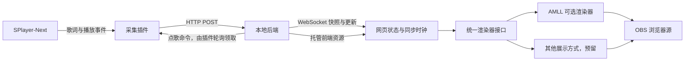

# 架构方案

日期：2026-11-11。产品方向已确认，下面的传输、同步与工程方案仍需验证。

## 数据流

## 职责

| 部分 | 职责 | 交付形式 |
| --- | --- | --- |
| 插件 | 采集歌词与状态；领取后端命令并调用宿主搜索、播放接口 | 单文件插件；本次提供独立点歌验证插件 |
| 本地后端 | 歌词快照与分发；命令提交、分派及结果回收 | 独立本地进程，正式启动形式待定 |
| 网页公共层 | 接收数据、维护时钟、管理渲染器选择与生命周期 | OBS 加载的网页 |
| 渲染器 | 将统一歌词数据和时间转换为具体画面 | 按需加载的独立模块 |
| 预览／设置页 | 选择展示方式、查看诊断、预览样式 | 建议与输出页面分开 |

建议首版后端只监听 `127.0.0.1`，网页与其 WebSocket 共用同一来源。
公共数据类型和后端不依赖 AMLL，完整保留歌词信息供不同渲染器使用。

## 插件边界

[插件运行环境](../SPlayer-docs/docs/plugins/index.md)没有 Node 模块导入、`require`、DOM 或 Electron API。
文档未提供监听 HTTP 服务、启动子进程或建立 WebSocket 客户端的接口。
建议使用已文档化的 [splayer.request](../SPlayer-docs/docs/plugins/api.md#request) 向独立后端发送 HTTP POST；
不假设插件可以自动启动后端。

订阅 `trackChange`、`lyricChange`、`lineChange`、`playStateChange`，取得初始快照及后续变化。
换行事件不提供连续逐字进度，因此建议定期调用 `getNowPlaying()` 校准，获得进度、倍率、歌词偏移和采样时间戳。
该查询要求 API 4 和 `control` 权限，上传要求 `network`。
新增点歌需求也使用 `control` 执行 `playTrack`，使用 `network` 调用 `searchOnline`。
可先在 250–500ms 区间验证采样周期，实际取值由宿主开销和同步目标决定。

## 上传与状态恢复

建议消息带协议版本、插件会话、单调序号、曲目修订、歌词修订和采样时间。
这些字段属于本项目拟定协议，不是 SPlayer 原有字段。

- 曲目／歌词变化时提交必要的完整数据；进度采样仅提交轻量状态。
- 单请求执行并合并待发送状态，避免积压；失败采用有上限的重试间隔。
- 后端拒绝旧会话或旧序号，定义会话接管规则；插件以确认结果推进发送状态。
- 后端重启或要求重新同步时，插件发送完整快照。
- 网页新连接先取得完整快照，再接收更新；订阅和快照读取之间不能遗漏变化。

宿主 `lyricChange` 只有 `lines`，没有曲目 ID；快照与快速切歌时的事件顺序未明确保证。
需实测归属，设计切歌后的歌词待确认和旧请求作废规则；本项目消息序号不能单独解决宿主事件归属。

## 统一展示时钟

网页依据最近采样位置和播放倍率，用单调时钟估算连续进度。
暂停时冻结，seek 时校准；停止、失联和场景恢复时应用明确策略。
所有渲染器读取同一时钟，不分别连接 SPlayer、发起轮询或自行计算网络校准。

宿主时间戳、后端时间和网页 `performance.now()` 是不同时间基准，不能直接相减。
M2 需验证采样锚点映射、延迟估计、歌词偏移的正负号和只应用一次的规则。
同步误差同时对比宿主进度与 OBS 实际呈现；平滑动画本身不能证明同步正确。

## 可替换渲染

[渲染器接口草案](renderers.md)定义输入、能力声明、生命周期、更新节奏和资源释放。
逐字动画方式可消费逐帧时间，轻量方式可仅消费行变化，公共层按能力调度。
AMLL 动态导入及专有 CSS 留在其适配模块，未选择时不初始化；其他模式的性能不受其运行循环影响。

## 工程建议

建议 TypeScript 前后端共享本项目的数据契约；前端可评估 Vue 3，也可直接使用 DOM 组件。
具体框架、构建器和版本待歌词链路验证后固定；本轮点歌实验使用 Node 内置 HTTP，无第三方依赖。
首版采用插件采集路径，不要求用户额外开启 SPlayer 的 HTTP／WebSocket 外部 API。

## 后端到宿主的命令方向

独立验证采用插件轮询后端领取 `requestSong` 命令，调用 `searchOnline` 后将 `tracks[0]` 原样传入 `playTrack`，
随后用 `getNowPlaying` 确认目标曲目及状态，再回报结果。
命令类型作为未来处理器扩展边界，歌词上传与命令执行相互独立，不绑定具体渲染器。
验证程序不是正式命令系统，不承担持久化、多用户排序和重启恢复。
接口与实测证据见 [点歌与后端控制](song-requests.md)。
直播间到后端建议采用独立 B 站消息流适配器，再经解析层调用命令服务；
目前只有 [资料层面的方案](bilibili-ingress.md)，不包含接入代码或连接验证。
