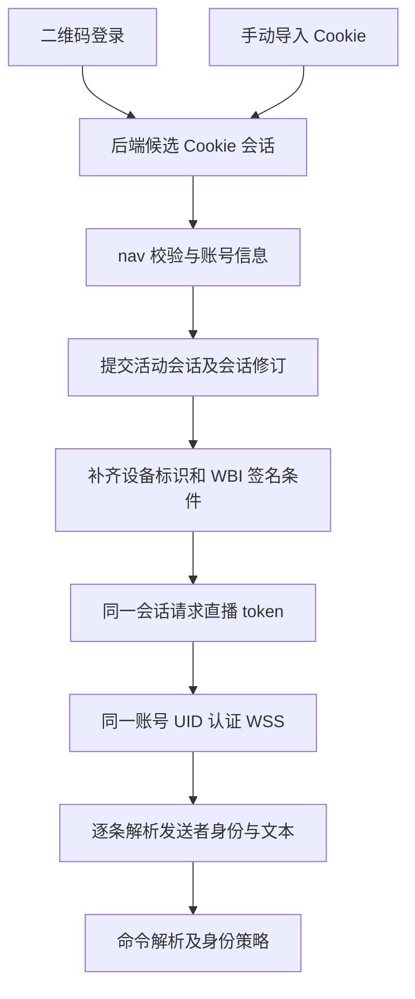

# B 站鉴权与用户信息方案

日期：2026-11-11。根据用户补充，优先研究带登录态的弹幕接入，以获得登录账号信息及平台实际提供的弹幕发送者信息。
建议二维码登录作为主要入口，手动导入 Cookie 作为备选，两者统一进入后端会话管理。
本文保留方案依据。用户随后授权实现最小网页示例，现已提供 [运行与验收入口](../experiments/bilibili-live/README.md)。
示例支持二维码／Cookie 登录和直播消息流。本次已实测真实二维码显示和游客收弹幕，扫码后的账号登录和发送者身份仍待用户验收。

## 资料与结论边界

资料基线与 [弹幕接入方案](bilibili-ingress.md) 相同：本地参考仓库提交 `cfc5fddcc8a94b74d91970bb5b4eaeb349addc47`。
接口和字段先据社区资料快照整理；实测扫码 URL 的域名是 `account.bilibili.com`，与快照示例不同。现已允许该域和原有 `passport.bilibili.com` 的 HTTPS 扫码链接。

| 参考文档 | 本方案使用内容 |
| --- | --- |
| [二维码登录](../../bilibili-api-collect/docs/login/login_action/QR.md) | 申请二维码、轮询、Cookie 与刷新令牌 |
| [登录基本信息](../../bilibili-api-collect/docs/login/login_info.md) | 校验登录、读取账号 UID、昵称和头像 |
| [Cookie 刷新](../../bilibili-api-collect/docs/login/cookie_refresh.md) | 刷新条件和新旧令牌交接 |
| [设备标识](../../bilibili-api-collect/docs/misc/buvid3_4.md)及 [WBI 签名](../../bilibili-api-collect/docs/misc/sign/wbi.md) | 直播认证前置条件 |
| [直播间信息流](../../bilibili-api-collect/docs/live/message_stream.md) | 认证 UID 一致性、发送者信息与未登录限制 |

## 两类用户信息

| 对象 | 来源 | 用途 |
| --- | --- | --- |
| 登录接收账号 | 登录或导入 Cookie 后由 `nav` 校验 | 设置页展示账号、取得直播 token、以同一账号认证连接 |
| 弹幕发送者 | 每条 `DANMU_MSG` 的发送者字段 | 点歌归属、未来用户冷却或权限判断 |

只需由本应用使用的一个接收账号登录，不要求每位观众在本应用登录。
接收账号不必预设为房主账号，也不能将房主 UID 或接收账号 UID 填入每条弹幕的发送者字段。
资料描述未登录连接可能收到 `mid=0` 和脱敏昵称，因此本项目优先采用已登录路径。
登录仍不能保证所有发送者身份完整；神秘用户、脱敏字段和平台策略都需要明确标记。

## 登录方式

### 二维码登录：建议默认

1. 设置页向本地后端发起登录，后端请求 `passport.bilibili.com/x/passport-login/web/qrcode/generate`，保留 `qrcode_key`，将二维码图像或扫码 URL 交给设置页展示。
2. 后端负责请求同域 `/x/passport-login/web/qrcode/poll`。资料给出的有效期为 180 秒；到期或取消后停止轮询，由用户重新发起。
3. 分别检查响应根级 `code` 和 `data.code`，不能把根级成功当作登录成功。
4. 成功时由后端 Cookie jar 接收全部适用的 `Set-Cookie`，保存可用的 `refresh_token`；再校验账号，校验通过才提交为活动会话。

| `data.code` | 设置页状态 |
| --- | --- |
| `86101` | 等待扫码 |
| `86090` | 已扫码，等待手机确认 |
| `86038` | 已过期，等待重新发起 |
| `0` | 凭据已取得，进入账号校验 |

文档列出的登录 Cookie 包括 `SESSDATA`、`bili_jct`、`DedeUserID` 和 `DedeUserID__ckMd5`。
本地网页不直接读取 B 站 HttpOnly Cookie；后端不把含凭据的成功跳转 URL、Cookie 或刷新令牌返回设置页。
二维码完成不代表已有 `buvid3`，也不代表直播消息流已认证成功。

### Cookie 导入：建议备选

设置页接受用户明确粘贴的 Cookie 字符串，经本地管理接口交给后端；不自动读取浏览器账号数据库。
后端解析为独立候选会话，保留值的编码，不对 `SESSDATA` 重复解码或编码；导入字段不直接覆盖已校验账号。
以 `nav` 校验成功后才替换活动会话，设置页展示服务端确认的 UID、昵称和头像，并清空输入框。

Cookie 导入不保证包含 `refresh_token`。`bili_jct` 是 CSRF 字段，`buvid3` 是设备标识，两者都不能单独证明已登录。
只有 Cookie 字符串时，无法恢复原始 Cookie 的全部到期、域和路径属性；导入器需按已知服务域建立作用域，后续响应保留实际 `Set-Cookie` 属性。
本阶段不扩展密码、短信或客户端 access token 登录方式。

## 统一会话与连接流程

账号校验依据 `api.bilibili.com/x/web-interface/nav` 的根级 `code=0`、`data.isLogin=true`，并读取 `data.mid`、`uname`、`face`。
账号 UID 以该结果为准，不仅信任导入的 `DedeUserID`。资料描述 `code=-101` 表示未登录；超时、网络中断等另记为暂时无法校验，不直接清空凭据。
`nav` 的 `wbi_img` 在未登录时也可能存在，取得签名密钥不等于账号校验成功。

后续连接使用同一活动会话完成以下步骤：

1. 解析直播间真实 ID；检查 `buvid3`，缺失时按设备标识文档单独获取并写入 Cookie jar，不复制文档中的示例值。
2. 按 WBI 文档生成签名，以该会话请求 `getDanmuInfo`，取得 token 和节点。
3. WSS 认证包的 `uid` 使用已校验的接收账号 UID，`roomid` 使用真实房间 ID；不能混用其他账号获取的 token。
4. 认证回复成功后才将房间状态记为已连接；心跳、压缩包解码及重连流程见 [弹幕接入方案](bilibili-ingress.md)。

登录有效、房间认证成功、单条消息身份可用是三个独立结果。即使账号有效，房间连接或字段获取仍可能失败。

## 发送者字段与内部边界

资料给出的文本字段为 `info[1]`；发送者 UID／昵称可见于 `info[2][0]`、`info[2][1]`，
增强结构还包括 `info[0][15].user.uid`、`user.base.name`、`user.base.face`、`user.base.is_mystery`。
适配器需兼容字段缺失、结构变化及两组字段不一致，不能把固定数组下标未经检查地暴露给命令层。

建议规范化事件保留以下边界，具体类型在工程阶段确定：

| 字段 | 含义 |
| --- | --- |
| `sourcePlatform`、`roomId`、`messageId?`、`text`、`sentAt?` | 来源、房间、可用消息标识、文本和平台时间 |
| `receiverAccountId`、`sessionRevision` | 接收账号和所属会话，供内部隔离与排错 |
| `senderUid?`、`senderName?`、`senderAvatar?` | 平台实际提供且可使用的发送者信息；未知时留空 |
| `identityStatus` | 建议为 `identified`、`restricted`、`unavailable`；受限或冲突时不宣称身份完整 |

用户唯一标识使用“来源平台 + 可信发送者 UID”，昵称只用于显示；`0` 不作为真实 UID，也不把昵称或文本哈希当作用户身份。
神秘用户或字段冲突时保留限制标记；后续不得通过补查资料绕过脱敏。
建议依赖身份的冷却、权限等指令在身份不可用时明确拒绝；普通点歌是否允许匿名继续执行，留作实施前的产品选择。
该事件是未来正式后端的内部模型，现有 `requestSong` 实验请求不增加这些字段，也不因此宣称已经支持用户策略。

## 生命周期和本地保存

后端会话服务统一承担登录、导入、校验、断开和未来刷新；平台适配器仅取得受控的会话引用。
设置页分别显示账号状态（未登录／登录中／校验中／有效／需重新登录／暂时无法校验）和房间状态（未连接／连接中／已连接／失败）。
身份可用性按消息记录，不用一条成功消息证明后续身份总是完整。

- 首次实现优先完成有效性校验与失效后重新扫码／导入，预留自动刷新接口，不把刷新当作本轮交付。
- 刷新资料要求 `bili_jct`、`refresh_csrf` 和 `refresh_token`；成功后需用新 Cookie 加旧刷新令牌确认。若未来实施，应保留旧令牌至交接完成，将新 Cookie 与新令牌作为同一会话修订保存。
- 切换账号或本地断开时，停止旧连接及重连任务，使旧轮询、token 请求和消息回调作废，避免旧会话结果覆盖新账号。
- “本地断开并移除凭据”作为默认退出行为；调用平台退出接口属于另一项操作，可能影响共用 Cookie 的浏览器会话。
- 凭据只留在本地后端。Windows 持久化候选为系统凭据存储或用户级 DPAPI；具体库待工程选型，不能用 Base64 代替加密。
- 管理接口与 OBS 输出权限分开，账号变更接口校验本地管理会话与来源；OBS 页面只接收展示数据。日志不记录 Cookie、刷新令牌、扫码密钥及含凭据 URL，凭据文件不纳入 Git。

## 未来验证顺序

下列为完整方案的验收顺序；最小示例的实际支持范围及人工步骤见 [示例说明](../experiments/bilibili-live/README.md)。
该示例登录态只存内存，暂不实现重启恢复、自动刷新或弹幕命令执行。

1. 二维码未扫描、已扫描待确认、成功、取消、过期；确认 Cookie jar 收到凭据，设置页只看到状态与账号资料。
2. Cookie 导入有效、无效、缺失字段与暂时网络失败；校验 UID，失败导入不破坏原活动会话。
3. 程序重启后恢复并重新校验；本地移除或切换账号时，旧异步任务不能回写或继续分派命令。
4. 账号有效后再验证设备标识、WBI、直播 token 与同 UID 的 WSS 认证；逐阶段记录失败，不把登录成功当作弹幕接入通过。
5. 连接验证获准后，再由不同观众发送消息，核对发送者身份与接收账号不同；覆盖 UID 缺失、脱敏、神秘用户和字段冲突。
6. 最后才接入命令解析，验证正常点歌、身份策略、去重与忙碌处理；已有后端到 SPlayer 的实测结论保持独立。

正式实施前仍需确定匿名点歌策略、持久化选型和后续是否纳入自动刷新。目标房间由用户在示例页面填写，登录亦由用户在本地完成。
