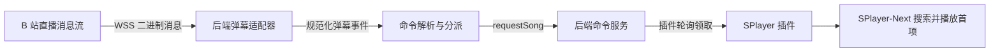

# B 站直播间到后端：可行性方案

日期：2026-11-11。[最小网页示例](../experiments/bilibili-live/README.md)已实测游客可认证、维持心跳并收到弹幕文本；登录后的发送者信息待验收。
以下保留资料依据。示例提供账号及游客连接，不向点歌后端分派命令。
根据用户补充，优先采用带登录态的方案，以获取账号与弹幕发送者信息；详见 [鉴权与用户信息](bilibili-auth.md)。

## 资料基线

| 项目 | 本次读取 |
| --- | --- |
| 本地目录 | `E:/Zero_Work_Folder/Project/1.Fun_Project/bilibili-api-collect` |
| 分支 | `master` |
| 提交 | `cfc5fddcc8a94b74d91970bb5b4eaeb349addc47` |
| 工作区 | 读取时干净，本轮保持只读 |

主要依据为本地 [直播间信息流](../../bilibili-api-collect/docs/live/message_stream.md)、
[房间信息](../../bilibili-api-collect/docs/live/info.md)及 [WBI 签名](../../bilibili-api-collect/docs/misc/sign/wbi.md)。
该项目是接口资料集合，不是开箱即用的弹幕转发服务；[项目说明](../../bilibili-api-collect/README.md)也说明部分资料可能未及时更新。
快照用于整理候选方案，当前服务行为以实际验证记录为准。

## 建议路径



建议弹幕适配器作为本地后端中的独立模块，负责平台连接与事件转换。
解析层将「点歌 xxx」转换为既有 `requestSong`，后续更多指令在分派层扩展。
歌词网页和具体渲染器不负责连接直播间。

## 连接流程的资料依据

1. 通过二维码登录或手动导入 Cookie 建立后端会话，由 `nav` 校验登录有效并取得接收账号 UID；具体路径仍属建议。
2. 通过房间信息将用户填写的短号解析为真实房间 ID，检查并补齐设备标识条件。
3. 使用真实 ID 和同一登录会话请求 `getDanmuInfo`，取得认证 token 和服务器节点；文档要求 WBI 签名及非空 `buvid3`。
4. 连接所返回节点的 WSS `/sub`，认证包使用该接收账号 UID、真实房间 ID 和 token；检查认证回复，随后维护心跳与重连。
5. 按包头长度拆分数据包，处理普通 JSON、zlib 和 Brotli 压缩及解压后的嵌套包。
6. 识别 `DANMU_MSG`，由 `info[1]` 读取弹幕文本，从发送者字段提取身份与可用性，将平台载荷转成内部事件。

以上是账号接入路径，登录后的真实接口行为仍待验收。连接、认证、心跳与解压是接入模块的职责，不能把整个 WebSocket 帧直接当一条 JSON。
文档说明未登录连接可能缺失真实用户 ID 或显示脱敏昵称，本项目因此优先带登录态接入。
账号校验、直播认证和实际发送者身份可用性分别验收；即使已登录，仍不能保证每条消息都有可识别身份。

游客路径使用新的 Cookie jar，不携带账号 Cookie；`nav` 返回未登录时仍可取得 WBI 签名信息，后端使用该会话取得直播 token，以 `uid=0` 认证。
实测公开房间 `6963590` 认证及心跳成功，收到 3 条弹幕，发送者 UID 均缺失且昵称均脱敏。详见 [游客实测记录](../experiments/bilibili-live/guest-validation.json)。

## 接入现有后端

输入事件建议保留平台、真实房间 ID、文本、原始发送时间及可用的消息 ID／发送者信息。
接收账号与发送者 UID 分开记录，未知身份不填 `0` 或虚构昵称；字段草案及受限状态见 [鉴权方案](bilibili-auth.md#发送者字段与内部边界)。
字段缺失由平台适配器处理，公共命令服务不直接读取 B 站的嵌套数组。

解析规则建议先只接受明确的「点歌 + 空白 + 非空关键词」，去除首尾空白后生成：

```json
{ "type": "requestSong", "query": "晴天", "platform": "netease" }
```

这里的 `platform` 是音乐搜索音源，由应用配置决定，不是弹幕来源平台。
同进程模块调用后端命令服务即可，现有实验程序的 `POST /api/commands` 可作为未来验证入口。

建议解析层通过命令注册表分派类型，未注册的指令忽略；事件去重与命令执行结果分开管理。
优先使用可用消息 ID 去重；资料不保证每条消息都有统一 ID，缺失时的退化规则需要后续明确，不能仅按文本去重。
当前实验后端同时只允许一条未完成命令，会返回忙碌状态；如何处理连续点歌、冷却和排队尚未设计或实现。

## 以后实施前需明确

- 目标房间、二维码／Cookie 接入实现及登录态保存方式；需要用户信息的方向已确认。
- 身份缺失或受限时，普通点歌是否允许继续；身份相关指令建议明确拒绝。
- 当前服务对签名、Cookie、认证字段和消息结构的实际要求。
- 稳定消息 ID、重连去重、过期弹幕及短时高频点歌的处理规则。
- 命令忙碌、无搜索结果和歌曲不可播放时，如何向主播反馈。

这些属于正式应用的前置条件；最小示例由用户在本地完成登录并输入房间号，不通过对话索取凭据。
后续凭据由后端会话服务管理并保护本地持久化，不进入 OBS 输出页或版本库。

## 当前完成范围

已完成资料阅读、方案梳理及与现有命令入口的对接分析，并按后续授权实现独立登录与收弹幕示例。
游客连接与弹幕文本已通过真实验证，登录后的身份信息和端到端点歌尚未验证。
之前已实测通过的部分仍仅为 [后端到 SPlayer](song-requests.md)。
