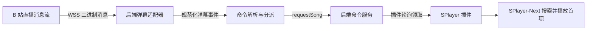

# B 站直播间到后端：可行性方案

日期：2026-11-11。结论：按现有资料存在可行接入路径，尚未进行任何直播间连接或功能验证。
本次仅阅读文档并提出方案，不编写接入代码，不获取令牌、不建立 WebSocket、不发送弹幕或触发点歌。

## 资料基线

| 项目 | 本次读取 |
| --- | --- |
| 本地目录 | `E:/Zero_Work_Folder/Project/1.Fun_Project/bilibili-api-collect` |
| 分支 | `master` |
| 提交 | `cfc5fddcc8a94b74d91970bb5b4eaeb349addc47` |
| 工作区 | 读取时干净，本轮保持只读 |

主要依据为本地 [直播间信息流](../../bilibili-api-collect/docs/live/message_stream.md)、
[房间信息](../../bilibili-api-collect/docs/live/info.md)及 [WBI 签名](../../bilibili-api-collect/docs/misc/sign/wbi.md)。
该项目是接口资料集合，不是开箱即用的弹幕转发服务；[项目说明](../../bilibili-api-collect/README.md)也说明部分资料可能未及时更新。
这里只判断文档描述能否组成完整方案，不把快照等同于当前服务的实测行为。

## 建议路径



建议弹幕适配器作为本地后端中的独立模块，负责平台连接与事件转换。
解析层将「点歌 xxx」转换为既有 `requestSong`，后续更多指令在分派层扩展。
歌词网页和具体渲染器不负责连接直播间。

## 连接流程的资料依据

1. 通过房间信息将用户填写的短号解析为真实房间 ID。
2. 使用真实 ID 请求 `getDanmuInfo`，取得认证 token 和服务器节点；文档要求 WBI 签名及非空 `buvid3`，登录态按功能需要另行确定。
3. 连接所返回节点的 WSS `/sub`，发送认证包并检查认证回复，随后维护心跳与重连。
4. 按包头长度拆分数据包，处理普通 JSON、zlib 和 Brotli 压缩及解压后的嵌套包。
5. 识别 `DANMU_MSG`，由 `info[1]` 读取弹幕文本，将平台载荷转成内部事件。

以上步骤来自资料，不代表已对真实接口请求成功。连接、认证、心跳与解压是接入模块的职责，不能把整个 WebSocket 帧直接当一条 JSON。
文档说明未登录连接可能缺失真实用户 ID 或显示脱敏昵称；后续不要把可识别的用户身份作为每条点歌的默认前提。

## 接入现有后端

输入事件建议保留平台、真实房间 ID、文本、原始发送时间及可用的消息 ID／发送者信息。
字段缺失由平台适配器处理，公共命令服务不直接读取 B 站的嵌套数组。

解析规则建议先只接受明确的「点歌 + 空白 + 非空关键词」，去除首尾空白后生成：

```json
{ "type": "requestSong", "query": "晴天", "platform": "netease" }
```

这里的 `platform` 是音乐搜索音源，由应用配置决定，不是弹幕来源平台。
同进程模块调用后端命令服务即可，现有实验程序的 `POST /api/commands` 可作为未来验证入口。

建议解析层通过命令注册表分派类型，未注册的指令忽略；事件去重与命令执行结果分开管理。
优先使用可用消息 ID 去重；资料不保证每条消息都有统一 ID，缺失时的退化规则需要后续明确，不能仅按文本去重。
当前实验后端同时只允许一条未完成命令，会返回忙碌状态；如何处理连续点歌、冷却和排队尚未设计或实现。

## 以后实施前需明确

- 目标房间、是否需要识别用户，以及采用何种登录态配置。
- 当前服务对签名、Cookie、认证字段和消息结构的实际要求。
- 稳定消息 ID、重连去重、过期弹幕及短时高频点歌的处理规则。
- 命令忙碌、无搜索结果和歌曲不可播放时，如何向主播反馈。

这些属于以后验证的前置条件，本轮不索取账号信息或房间号。
凭据如后续引入，应留在本地后端配置中，不进入 OBS 输出页或版本库。

## 当前完成范围

已完成资料阅读、方案梳理及与现有命令入口的对接分析。
尚未证明真实房间可连接、弹幕可收到、签名当前有效或端到端点歌可执行。
之前已实测通过的部分仍仅为 [后端到 SPlayer](song-requests.md)。
