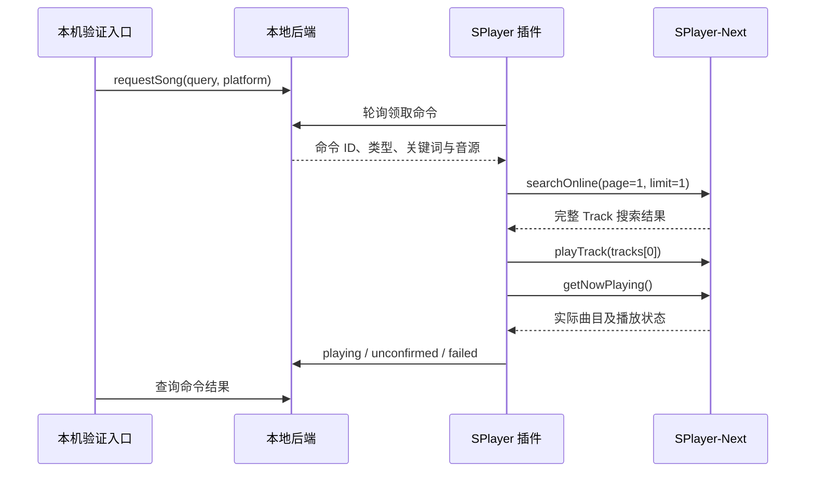

# 点歌与后端控制验证

日期：2026-11-11。长期需求已记录，本次仅验证后端到 SPlayer-Next 的执行链路。

## 需求边界

未来直播用户发送「点歌 xxx」时，自动搜索关键词并播放搜索顺序的第一个结果。
后续可能扩展其他指令，因此保留命令类型和执行结果结构。
此前点歌专项未涉及直播间连接或弹幕获取；现已另行整理 [B 站输入方案](bilibili-ingress.md)，仅基于资料提出，尚未实施或连接验证。

第一项是选定音源返回的第一页第一项，不重新按歌手、原唱或热度排序；
没有结果则报告失败，第一项不可播放时不自动换成第二项。
目前验证直接请求播放该曲目；排队、合并、多用户顺序和指令权限策略以后再定。

## 已验证路径



插件没有文档化的入站服务监听能力，因此通过 `splayer.request` 主动轮询领取命令。
这是逻辑上的后端控制播放器，网络连接仍由插件发起；无需开启宿主的外部 HTTP／WebSocket API。

使用 API 4 的 [在线搜索](../SPlayer-docs/docs/plugins/api.md#search-online)、
[播放曲目](../SPlayer-docs/docs/plugins/control.md#play-track)和[当前曲目](../SPlayer-docs/docs/plugins/control.md#now-playing)，
需要 `network` 与 `control` 权限。直接把搜索返回的完整 Track 传给播放方法，避免丢失来源信息。

## 最小命令与状态

验证程序接收如下结构；这是实验接口，不代表已经冻结生产协议。

```json
{ "type": "requestSong", "query": "晴天", "platform": "netease" }
```

`type` 为未来指令分派预留，目前仅实现 `requestSong`。
音源明确为 `netease`、`qqmusic` 或 `kugou`；本次真人验证只使用 `netease`。

| 状态 | 含义 |
| --- | --- |
| `queued` | 后端已接收，等待插件领取 |
| `dispatched` | 已派给特定插件会话，尚无最终结果 |
| `playing` | 查询到目标 Track ID、source 匹配且宿主 state 为 playing |
| `unconfirmed` | 播放请求已接受，确认窗口内未观察到目标曲目正在播放 |
| `failed` | 搜索无结果、权限拒绝或接口调用失败，保留失败阶段 |
| `expired` | 后端等待超时，结果可能未知，不自动重新派发 |

`playTrack` 的 Promise 完成只代表请求发送成功，不能单独判定正在播放。
插件在确认窗口中查询状态，不重复发送播放请求；回报上传失败时仅重试回报。

## 2026-11-11 实测

用户已在正在运行的 SPlayer 中导入并启用专用验证插件，并同意用「晴天」、网易云进行测试。

| 项目 | 实测结果 |
| --- | --- |
| 宿主 | SPlayer-Next 1.2.0，插件 API 5 |
| 后端 | Node.js v24.21.0，`127.0.0.1:19630` |
| 搜索 | `query=晴天`、`platform=netease`、`page=1`、`limit=1` |
| 第一项 | `晴天 (原唱 周杰伦)`，ID `2668397359`，source `netease` |
| 命令结果 | `playing`，`requestAccepted=true`，确认阶段完成 |
| 后端接收至收到确认 | 约 3.26 秒，单次测量，不是延迟承诺 |
| 命令 ID | `20ce133b-ff94-4be8-868e-b34e4293d604` |

本次证据为宿主状态查询确认，不包含声音采集、OBS 画面或其他音源的真机验证。
机器可读结果见 [validation.json](../experiments/song-request/validation.json)。

## 交付与后续

[独立验证程序](../experiments/song-request/README.md)包含后端、可导入插件、命令行入口与测试。
六项自动化测试使用真实 HTTP 后端和实际插件文件，替换 SPlayer 接口验证正常与失败分支；
自动化结果与上面的真实宿主验证分别记录。

后续正式后端可保留命令 ID、类型、参数、会话和结果分派边界，再加入其他指令处理器。
持久化、并发策略、重启恢复以及正式桥接协议在工程阶段确定，本次内存验证程序不承担这些职责。
